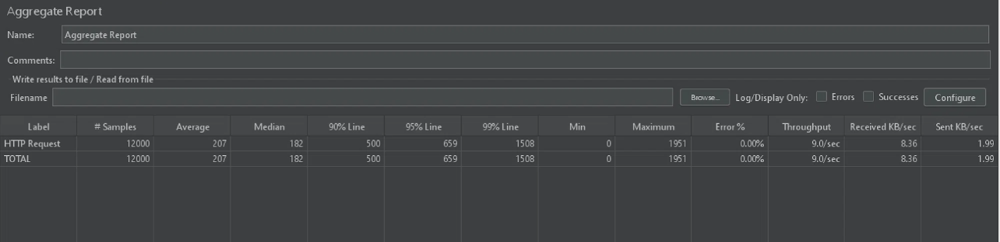
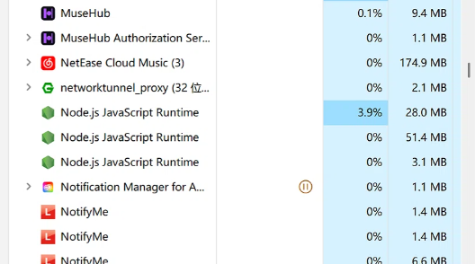
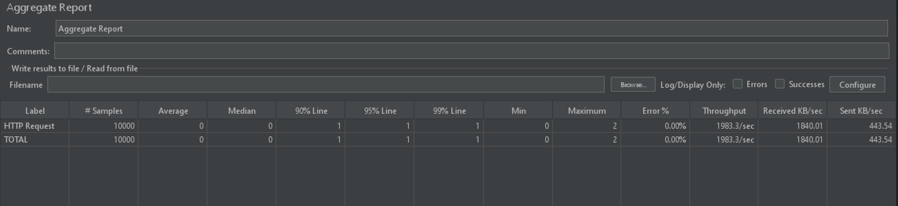
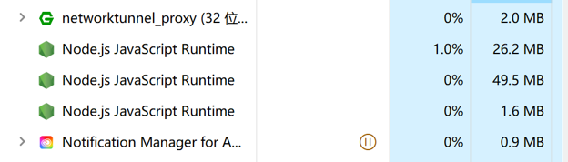

# 第 9 周：性能基线与优化报告

## 1. 测试环境与口径声明
* **测试环境：** 本地 Windows 环境，Node.js (Express)，并发 500 线程。
* **测试口径：** 统一采用 JMeter 聚合报告。统计 P95 响应时间、有效吞吐量（TPS）、HTTP 非 200 错误率。优化前后的测试环境、接口及数据量完全一致。

## 2. 前后对比数据

| 测试指标 | 优化前 (基线) | 优化后 | 提升幅度 | 备注说明 |
| :--- | :--- | :--- | :--- | :--- |
| **并发数** | 500 | 500 | - | 口径一致 |
| **P95 响应时间** | 659 ms | 1 ms | **↓ 99.8%** | 消除了文件同步阻塞 |
| **吞吐量 (TPS)** | 9.0 | 1983.3 | **↑ 21900%** | 改为内存直读，性能飞跃 |
| **错误率** | 0.00% | 0.00% | - | 系统运行稳定 |
| **CPU 占用** | 高频阻塞排队 | 1% ~ 3% | 显著下降 | 内存缓存 + 异步落盘 |

## 3. 优化证据链

### 3.1 瓶颈分析
基线压测（500并发，总计12000请求）时，发现 `/api/products` 接口 P95 响应时间高达 659ms，吞吐量仅 9.0 TPS。通过任务管理器监控发现，Node.js 主线程因高频 I/O 阻塞导致处理能力极差。查看代码发现，`store.js` 中的数据读写大量使用了 `fs.readFileSync` 和 `fs.writeFileSync` 同步读取本地 JSON 文件，在并发下导致主线程严重卡死，请求大量排队。

### 3.2 优化动作
修改 `server/src/services/store.js` 的数据存取逻辑：
1. **引入内存缓存机制**：在服务启动时（`ensureStructure` 阶段）将所有 JSON 数据全量加载至内存全局变量（`cache`），后续所有读请求直接返回内存数据，彻底消除高频读盘 I/O。
2. **异步防抖落盘**：将写入操作从 `fs.writeFileSync` 改为 `fs.promises.writeFile` 异步写入，并加入 500ms 防抖机制。这样不仅不阻塞主线程，还极大减少了高频并发下的磁盘读写次数。

### 3.3 效果验证 (截图)
* ****：优化前 JMeter 聚合报告（P95 659ms，TPS 仅 9.0）
* ****：优化前 CPU 占用监控
* ****：优化后 JMeter 聚合报告（P95 1ms，TPS 飙升至 1983.3）
* ****：优化后 CPU 占用监控（极其平稳，降至 1%~3%）